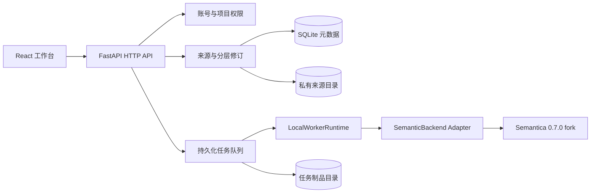

# Ontology Workspace

面向 FDE（Forward Deployed Engineer）与企业项目交付团队的本体构建工作台。

Ontology Workspace 将数据接入、本体分层建模、语义任务、场景验证和交付准备放在同一个项目空间中。项目以真实数据来源、不可变修订和任务证据为基础，通过固定版本的 Semantica 执行解析、抽取、图构建、OWL/RDF/SHACL 和推理相关能力。

> 当前版本：`0.1.0`。项目只开发工具，不内置行业场景模拟、业务数据或业务金标。

## 为什么要做这个项目

企业本体建设经常涉及业务访谈、数据盘点、概念建模、约束验证和交付治理。传统工具容易把这些工作拆散在表格、脚本、图数据库界面和文档中，FDE 很难持续回答几个关键问题：

- 当前模型依据哪些数据和业务事实？
- 类、关系、属性和规则属于哪个修订？
- 某次验证使用了哪份来源、模型和运行结果？
- 当前内容处于草稿、认证还是可发布状态？
- 后续修改会影响哪些依赖和交付物？

Ontology Workspace 围绕“项目空间 + 来源证据 + 分层修订 + 语义任务”组织这些工作，并在界面中明确区分已经实现的能力与仍待建设的能力。

## 适用角色

- FDE 与企业项目交付工程师
- 本体工程师、知识工程师与数据工程师
- 业务顾问、领域专家和模型评审人员
- 需要验证 Semantica 企业集成方式的研发团队

## 功能概览

### 1. 数据接入与理解

数据接入页面用于登记真实来源、执行解析并检查返回结果。

- 上传 CSV、JSON、PDF、DOCX 文件
- 为每次上传生成独立 `source_id`、来源修订、SHA-256 和大小记录
- 查看表格预览、字段结构、样本类型和空值提醒
- 查看文档正文或 JSON 根结构
- 保留解析任务的 `run_id` 和实际任务状态
- 从已解析来源进入本体构建工作流
- 展示受控数据库连接配置，同时明确区分“已配置”和“已读取”

单个来源文件当前限制为 1 MiB。JSON 请求体限制为 128 KiB。文件名只用于当前前端会话展示，服务端使用不可变来源标识和哈希保存证据。

### 2. FDE 本体构建工作流

本体构建采用五阶段单页切换，减少同时铺开多个编辑区域造成的信息拥挤。

| 阶段 | 当前页面能力 | 状态 |
| --- | --- | --- |
| 场景理解 | 汇总真实来源、语义任务和模型修订 | 已接后端 |
| 业务问题 | 展示能力问题与访谈结论所需的数据结构和接口边界 | 待持久化接口 |
| 模型方案 | 查看五类本体层，编辑并保存 JSON 草稿 | 已接后端 |
| 场景验证 | 展示真实 `validate_shacl` 任务、状态和结果证据 | 已接后端 |
| 交付中心 | 汇总各层修订和验证就绪度 | 发布操作待后端接口 |

页面不会生成虚构的访谈事实、候选三元组、业务问题、任务历史或业务金标。

### 3. 分层本体修订

工作空间支持五类分层内容：

- `tbox`：类、关系、属性等模式层内容
- `abox`：实例和事实层内容
- `shacl`：形状与约束
- `rules`：规则层内容
- `vocabulary`：受控词表与术语

每次保存都会生成新的不可变修订和 SHA-256，并推进项目的 `workspace_revision`。写入使用 CAS（Compare-And-Swap）校验；旧页面或旧任务不能覆盖更新后的工作空间。修订依赖必须指向同一项目中实际存在的对应层修订。

新修订初始状态为 `DRAFT`。专家认证与发布属于独立治理步骤，修改对象或依赖后，旧认证不会自动沿用。

### 4. 语义任务

后端当前支持七种语义任务：

| 操作 | 用途 |
| --- | --- |
| `ingest` | 将受控来源摄取为语义处理输入 |
| `parse` | 解析结构化文件或文档 |
| `extract` | 从文本中提取技术实体和关系候选 |
| `build_graph` | 构建图数据 |
| `ontology` | 导入、编辑、生成或导出本体 |
| `validate_shacl` | 执行 SHACL 验证 |
| `reason` | 执行受控规则推理 |

任务通过持久化队列运行，状态包括 `pending`、`running`、`succeeded`、`failed`、`cancelled` 和 `interrupted`。每次运行具有独立 `job_id` 与 `run_id`，支持事件记录、显式取消和受限重放。失败或中断任务不会被自动改写为成功记录。

当前前端直接开放文件解析、模型修订编辑和验证结果查看。其余语义任务已具备后端能力，仍需继续补充产品化操作页面。

### 5. Semantica 适配层

Semantica 固定为 `0.7.0+ontologyworkspace.5`，通过 `infrastructure/semantica_adapter` 与平台隔离。

- 平台 API 不直接暴露 Semantica 原生对象和异常
- 请求与结果通过稳定 DTO 校验
- 原生执行使用私有、有界的本地制品目录
- 输入在进入 Semantica 前执行格式、大小、路径和敏感信息检查
- Adapter 合同测试用于控制上游版本变化
- Fake Backend 仅用于自动化测试，不接入产品运行工厂

### 6. 项目、权限与审计

项目空间包含唯一 namespace、成员角色、来源、修订、任务和制品。当前角色包括：

- `engineer`
- `consultant`
- `expert`
- `admin`
- `owner`

权限按项目和操作检查，显式 deny 优先。关键操作会写入审计事件。

本地原型推荐使用 `--single-user`：浏览器无需登录，后端仍会建立内部 `workspace` 身份、项目角色、服务端会话和审计记录。多用户部署保留账号、Cookie 会话与项目授权机制。

## 系统架构



当前采用模块化单体结构：

- React 前端独立构建
- FastAPI 提供受控 HTTP 边界
- SQLite 保存账号、项目、修订、任务与审计元数据
- 私有文件目录保存来源快照和成功任务制品
- 单机 Worker 消费持久化任务
- Semantica Adapter 承担语义内核适配

## 技术栈

### 后端

- Python 3.12
- FastAPI / Starlette / Uvicorn
- SQLAlchemy + SQLite
- Pydantic
- Semantica `0.7.0+ontologyworkspace.5`
- RDFLib、pySHACL 相关语义依赖
- pytest

### 前端

- React 19
- TypeScript 5.9
- Vite 7
- Vitest + Testing Library
- 原生 CSS，无外部 CDN 字体和脚本

## 快速开始

### 环境要求

- Git
- Python `>=3.12,<3.13`
- [uv](https://docs.astral.sh/uv/)
- Node.js `>=22.12`
- pnpm

默认开发端口：

- 前端：`127.0.0.1:58229`
- 后端：`127.0.0.1:58230`

请先确认两个端口未被其他进程占用。Vite 配置启用了 `strictPort`。

### 1. 克隆仓库

```bash
git clone https://github.com/ShaohuaQi777/Ontology-Workspace.git
cd Ontology-Workspace
git checkout feat/p0-semantic-backend
```

当前完整工作版本位于 `feat/p0-semantic-backend` 分支。

### 2. 安装后端依赖

```bash
uv sync --locked --python python3.12
```

首次同步需要访问项目配置的软件源和 spaCy 模型地址。Semantica 使用仓库 `vendor/wheels` 中的固定 wheel。依赖已经缓存时，可以在后续验证中添加 `--offline`。

### 3. 安装前端依赖

```bash
cd frontend
pnpm install --frozen-lockfile
cd ..
```

### 4. 创建本地运行目录

```bash
mkdir -p .runtime/local/artifacts
chmod 700 .runtime/local .runtime/local/artifacts
```

元数据数据库不能放在 `artifact-root` 内。运行目录应保持私有，不要提交到 Git。

### 5. 启动后端

在仓库根目录执行：

```bash
uv run --locked python -m ontology_platform.api.server \
  --database "sqlite:///$PWD/.runtime/local/metadata.db" \
  --artifact-root "$PWD/.runtime/local/artifacts" \
  --origin http://127.0.0.1:58229 \
  --port 58230 \
  --insecure-dev \
  --single-user
```

参数说明：

- `--single-user`：启用本地免登录工作台身份
- `--insecure-dev`：允许回环地址上的本地 HTTP Cookie 配置
- `--origin`：允许写请求的精确前端 Origin
- `--database`：SQLite 绝对 URL
- `--artifact-root`：来源与任务制品的私有根目录

服务只允许绑定 `127.0.0.1`、`::1` 或 `localhost`。当前 CLI 不支持通过修改 host 直接公开部署。

### 6. 启动前端

打开第二个终端：

```bash
cd frontend
pnpm dev
```

浏览器访问：

```text
http://127.0.0.1:58229/data/
```

首次进入时可以直接新建项目。namespace 需要填写绝对 URI，例如：

```text
urn:example:ontology:
```

### 7. 检查服务状态

```bash
curl http://127.0.0.1:58230/healthz
curl http://127.0.0.1:58230/readyz
```

- `/healthz` 检查 HTTP 服务存活
- `/readyz` 检查数据库、固定 Semantica 版本和 Worker 状态

## 开发与测试

### 后端测试

```bash
uv run --locked python -m pytest -q
```

已有本地缓存时可以执行：

```bash
uv run --locked --offline python -m pytest -q
```

测试覆盖：

- 账号、会话、角色与项目权限
- 工作空间 CAS、修订依赖和认证失效
- 来源格式、大小、哈希和路径安全
- 持久化任务、取消、重放、事件与制品
- SemanticBackend DTO 与 Adapter 合同
- Semantica 原生能力和固定版本兼容性
- PDF/DOCX 等文档输入边界
- HTTP Origin、正文限额和错误响应

### 前端测试与构建

```bash
cd frontend
pnpm test
pnpm build
```

`pnpm build` 会先执行 TypeScript 类型检查，再生成 Vite 生产制品。

## 目录结构

```text
Ontology-Workspace/
├── contracts/                  # JSON Schema 与 OpenAPI 契约
├── contract_tools/             # 契约校验工具
├── docs/
│   ├── decisions/              # 架构决策记录
│   └── operations/             # 运行、安全和升级说明
├── frontend/                   # React / TypeScript 工作台
│   └── src/
│       ├── App.tsx             # 工作台外壳与数据接入
│       ├── OntologyWorkspace.tsx
│       ├── api.ts              # 固定同源 API 客户端
│       └── types.ts            # 公共前端 DTO
├── scripts/                    # 构建与验收脚本
├── src/ontology_platform/
│   ├── api/                    # FastAPI 路由与边界中间件
│   ├── application/            # 账号、工作空间、任务与 Worker
│   ├── domain/                 # 领域错误与连接定义
│   ├── infrastructure/         # SQLite、文件存储与 Semantica Adapter
│   └── semantic/               # 稳定语义 DTO 与 Backend Protocol
├── tests/                      # 单元、合同、服务与原生能力测试
├── vendor/wheels/              # 固定 Semantica wheel
├── pyproject.toml
├── uv.lock
└── README.md
```

## API 概览

主要 HTTP 路径：

```text
GET    /healthz
GET    /readyz

GET    /api/session/me
POST   /api/session/login
POST   /api/session/logout

GET    /api/projects
POST   /api/projects
GET    /api/projects/{project_id}/members
POST   /api/projects/{project_id}/members

GET    /api/projects/{project_id}/sources
POST   /api/projects/{project_id}/sources
GET    /api/projects/{project_id}/sources/{source_id}

GET    /api/projects/{project_id}/layers
PUT    /api/projects/{project_id}/layers/{layer}
GET    /api/projects/{project_id}/revisions/{revision_id}

GET    /api/projects/{project_id}/jobs
POST   /api/projects/{project_id}/jobs
GET    /api/jobs/{run_id}
GET    /api/jobs/{run_id}/events
POST   /api/jobs/{run_id}/cancel
POST   /api/jobs/{run_id}/replay
GET    /api/jobs/{run_id}/artifacts/{artifact_id}

GET    /api/projects/{project_id}/connections
POST   /api/projects/{project_id}/connections
```

服务默认关闭 Swagger、ReDoc 和公开 OpenAPI 页面。稳定契约保存在 `contracts/`。

## 数据与安全边界

- 不接受客户端提供任意服务器文件路径
- 来源按项目隔离，读取前重新校验权限、大小和 SHA-256
- 来源目录使用私有权限和随机文件名
- JSON 与文件输入均有固定大小预算
- DOCX 会检查 ZIP 路径、数量、解压大小和压缩比
- PDF 在持久化前执行有界预检
- 客户端身份 Header 不会被当作登录身份
- 写请求必须来自配置的精确 Origin
- 错误响应使用固定错误码，不回显原始密码、Token、路径或异常堆栈
- 成功制品只能通过任务 manifest 中的索引读取
- Fake Backend、测试夹具和合成结果不会接入产品运行链路

本项目当前提供应用级边界，不声明已经具备容器级资源隔离、公开 TLS、分布式租约或对抗同 UID 恶意进程的 OS 沙箱能力。

## 当前能力边界

下列内容仍处于待建设或未开放状态：

- 业务访谈材料和事实结论的结构化持久化
- Competency Questions 与业务验收样例管理
- 候选类、关系、属性和三元组的批量评审工作流
- 可视化类图、关系图和映射编辑器
- 数据库、API、知识库的真实读取链路
- 业务金标、竞争答案和回归套件
- 专家认证 HTTP 接口
- Release Manifest 生成、审批、签名和发布 API
- 部署、健康检查、回滚和生产运行面板
- PostgreSQL、公开 TLS 和分布式 Worker

`contracts/` 中存在 Scenario Pack、Validation Result 和 Release Manifest 等契约提案。这些契约用于稳定协作边界，不代表相应产品流程已经完成。

## 运维资料

- [环境锁定与复现](docs/operations/a0-environment.md)
- [本地后端服务](docs/operations/backend-service.md)
- [受保护 HTTP 边界](docs/operations/protected-http.md)
- [本地账号与权限](docs/operations/local-accounts.md)
- [工作空间修订](docs/operations/workspace-revisions.md)
- [语义任务](docs/operations/semantic-jobs.md)
- [Semantica 升级](docs/operations/semantica-upgrades.md)
- [连接配置](docs/operations/connections.md)

## 贡献方式

提交改动前，请至少执行相关模块测试和构建：

```bash
uv run --locked python -m pytest -q
cd frontend && pnpm test && pnpm build
```

实现新能力时请遵循以下原则：

- 先添加失败测试，再实现最小正确行为
- Semantica 调用只进入 `infrastructure/semantica_adapter`
- 新生成对象保持 `DRAFT`，认证与发布独立执行
- 前端不展示虚构的运行历史或模拟成功状态
- 不在源码、日志、元数据或发布包中保存明文凭据
- 已实现、已验证、规划中能力分别说明

## License

仓库当前未提供独立的项目级 `LICENSE` 文件。使用、修改或分发前，请先与仓库所有者确认授权范围。`vendor/` 中第三方组件的许可信息以其随附材料为准。
